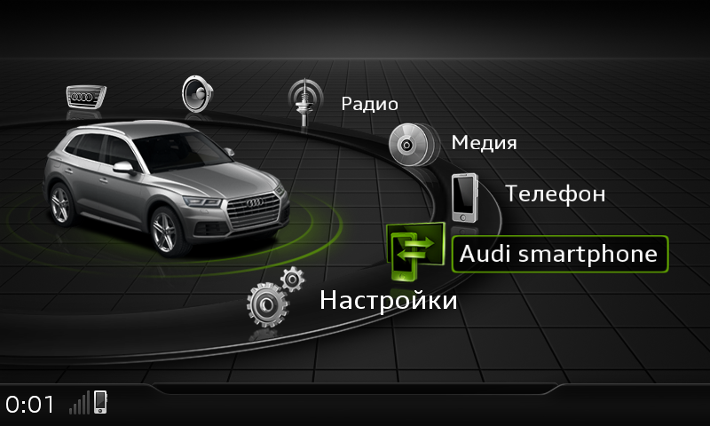
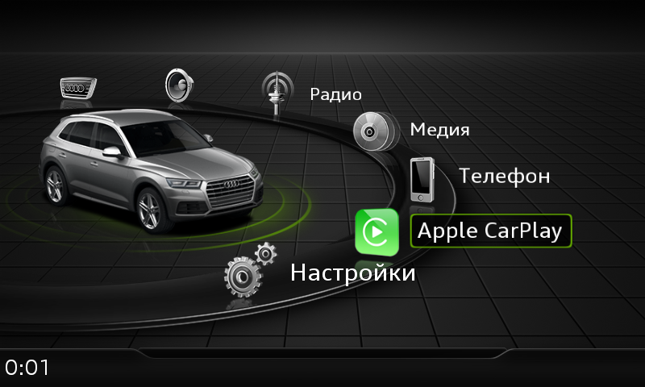
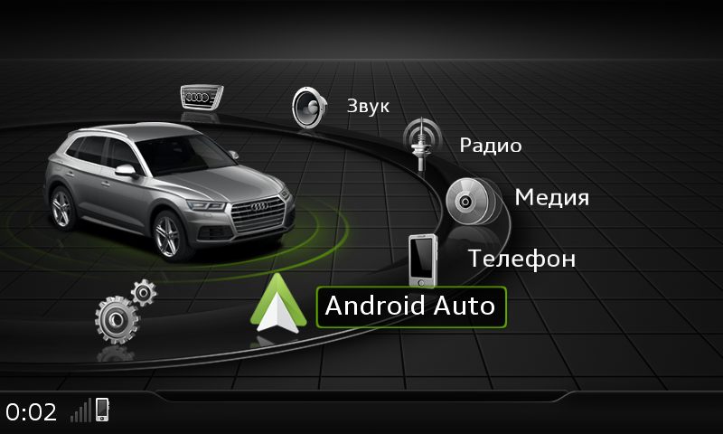
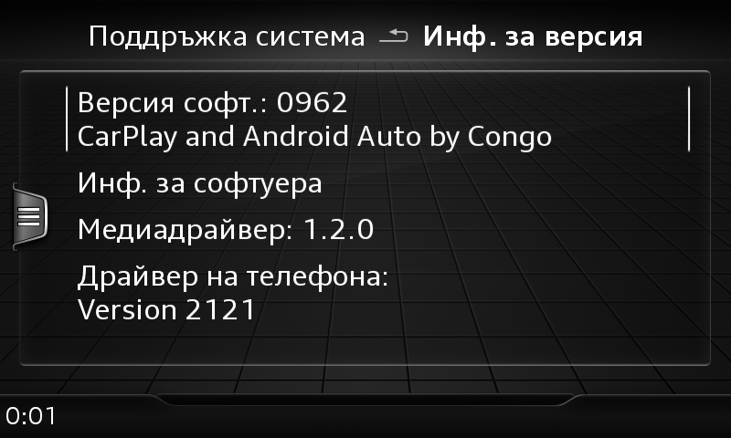
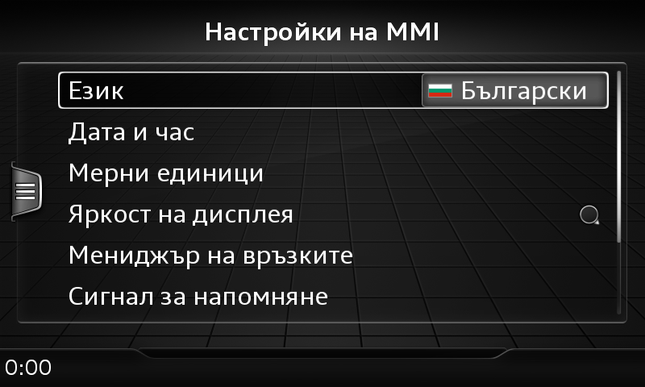

# MST2_EU_AU_P0962D_CP_AA_BG

Firmware update for the **Audi MIB2 STD2Plus** head unit (`MST2_EU_AU_P0962D`, HMI `HMI_AU_MIB2_S_EU_G21_C8P_174700`) that adds **Apple CarPlay**, **Android Auto** and a **Bulgarian** menu language to the original Audi software.

## New functionality

| Feature | What you get |
|---|---|
| **Apple CarPlay** | Wired CarPlay over the car's USB port, in the Audi menus (smartphone interface). |
| **Android Auto** | Wired Android Auto over USB. The MMI knob and buttons work in Android Auto. |
| **Bulgarian language** | *Settings > Language > Български*, with a Bulgarian flag. It is a new 41st language: Russian and all other languages are unchanged. |
| **Voice in Bulgarian mode** | Screens are Bulgarian. Navigation voice, voice control and spoken reminders (e.g. "mobile phone still in the vehicle") stay **English**, because the unit has no Bulgarian voice. |
| **Keyboard** | The text speller starts in Latin; Cyrillic is on the alphabet toggle. |
| **Version information** | *Settings > Version information* shows "CarPlay and Android Auto by Congo" under the software version, in every language. |
| **Production hardening** | No network login: telnet, ftp and rlogin are off, even with a USB-Ethernet adapter. |

## What was done

**CarPlay and Android Auto**
- The CarPlay and Android Auto programs come from the VW firmware `MST2_EU_VW_P0891D` (the same hardware platform, built the same day as the Audi software).
- They were patched to the Audi system's internal event numbering and to the Audi USB media handler, and added to the system process list.
- The USB port was switched to device mode, which CarPlay and Android Auto need.
- The Audi smartphone-interface screens were added to the HMI (`TerminalMode.jar`).

**Bulgarian language**
- **Translation:** all 13,400+ menu texts were translated. 12,710 were reused from an existing MHI2 Bulgarian translation where the English and Russian texts match exactly; the remaining 708 were newly translated and checked.

**Package**
- All checksums, block hashes and the package signature were recalculated, and the result was verified (`metainfo_tool.py --deep`: ALL OK).
- The PROD build differs from the test build `..._v18_BG` only in two `/ffs` files (`netstart`, `inetd.conf`) that no longer start network login.

**Tested on the car**
- CarPlay, Android Auto, Bulgarian menus and flag, English voice and reminders, and the Version information line all work.
- The system ran stable with automatic crash recovery switched back on (`platformrestart_no` removed).

## How to install

1. Download the software pack from [here](https://mega.nz/folder/1pg0mLbR#62Iy2sjDPBvMu1MiRGjokg)
2. Copy the **contents** of this folder to the root of an empty **FAT32 SD card**. `metainfo2.txt` must sit in the root of the card.
3. Start the engine, or connect a battery charger, so the voltage stays stable during the update. **Do not switch off the unit while it updates.**
4. Insert the SD card into the MMI.
5. Open the **green engineering menu** and activate **user defined mode** for the software update (SWDL).
6. Start the update: **Update > Manual SWDL**, choose the SD card, then **Select all**.
7. Confirm and wait until the update reports it is finished. The unit restarts by itself, maybe more than once.
8. Remove the SD card.

## After installing: check

- *Settings > Version information* shows "CarPlay and Android Auto by Congo".
- *Settings > Language > Български* switches the menus to Bulgarian.
- Connecting an iPhone (CarPlay) or an Android phone (Android Auto) by USB starts the smartphone interface.
- Optional: with a USB-Ethernet adapter, telnet to the unit is refused.

## Good to know

- **No remote shell.** The PROD build has no telnet or ftp. If shell access is ever needed (diagnosis, hot-swaps, the `/ffs/etc/bg_off` switch), flash the non-PROD package `MST2_EU_AU_P0962D_CARPLAY_v18_BG` the same way. It is identical except that telnet and ftp work with a USB-Ethernet adapter.
- **Back to stock.** Flash the original `MST2_EU_AU_P0962D` package the same way (Manual SWDL > Select all).
- **Other languages are unaffected.** They keep their own texts, voice and keyboard.

